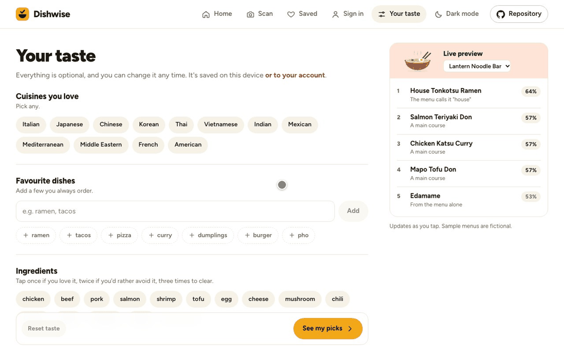
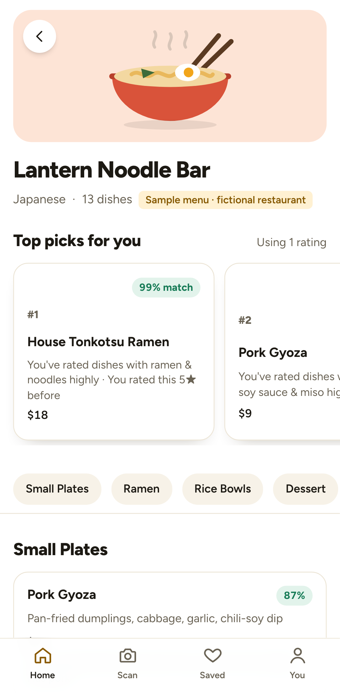
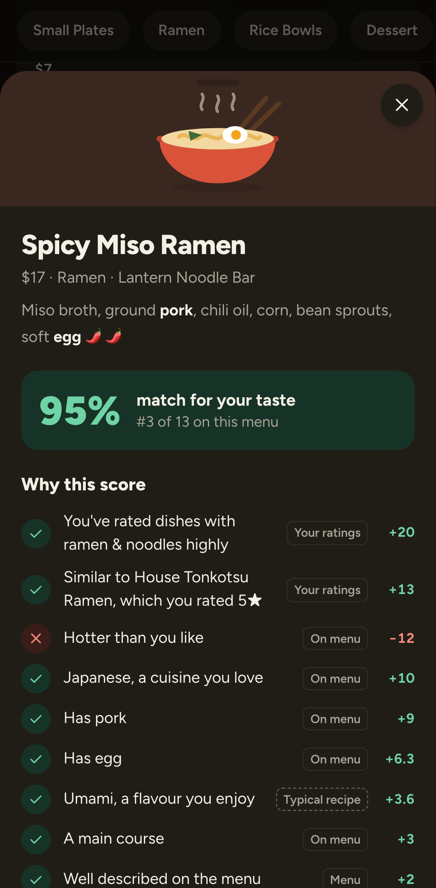
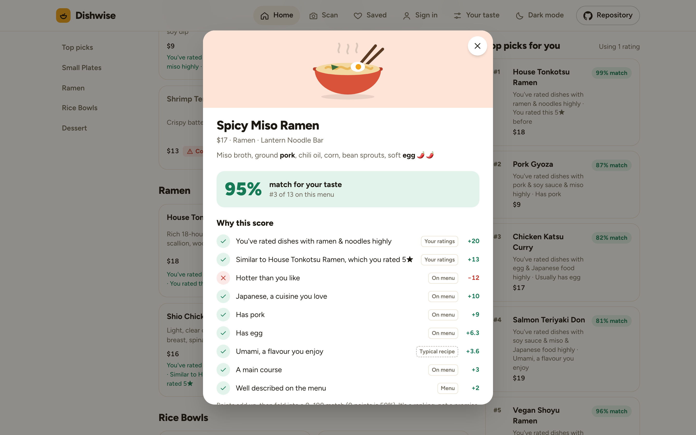
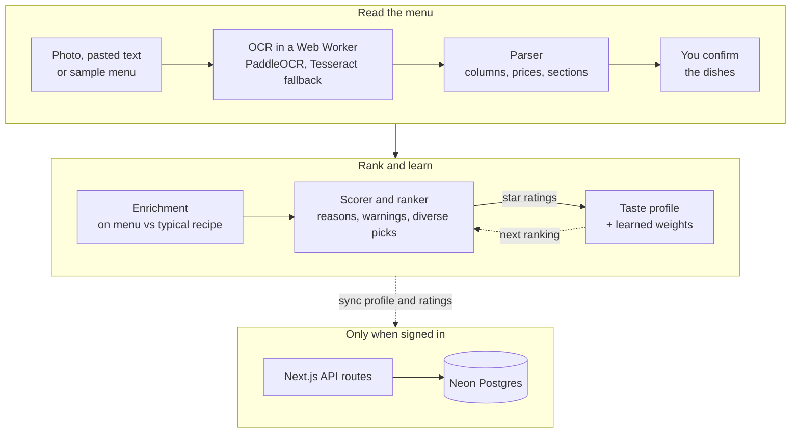

<p align="center"></p>

# Dishwise

**A menu reader that picks your dish and shows its work.** Point your phone at a menu, and Dishwise ranks every dish for your taste, explains each score point by point, and gets sharper with every rating.

**[Try it → dishwise.bhanusadhu.com](https://dishwise.bhanusadhu.com)** · works as a guest, costs nothing, and the photo is read on your phone.



<p align="center">
  
  &nbsp;
  
</p>

## The problem

You're at the table, the light is dim, the server is waiting, and the menu has forty items. If you avoid shellfish, hate cilantro or only want something mild, the menu rarely says enough, so you guess or play it safe. Restaurant ratings tell you whether a place is good, not which dish suits you. A chatbot can suggest something, but you can't see why it chose it or whether it knew about your allergy.

The bar Dishwise sets itself: **a pick you trust in under a minute.**

## How it works

1. **Say what you like.** Cuisines, favourite dishes, ingredients to seek or skip, heat tolerance, diet, allergies, budget. All optional; with an empty profile, picks come from what the menu itself signals, like house specials and mains.
2. **Give it the menu.** Snap a photo, paste the text from a website or delivery app, or open one of five sample menus. You confirm the scanned dishes before anything is ranked.
3. **Read the menu closely.** Each dish's ingredients, flavours and heat are pulled from its description and marked as either *on the menu* or *typical recipe*. What it can't tell stays blank.
4. **Rank and explain.** Every dish gets a 0–100 match built from visible reasons. Dishes that clash with your diet or allergies are moved aside with a warning, and the top picks are spread across the menu.
5. **Rate and improve.** Star a dish after you eat it. The weights behind that rating carry over to every menu you open next.



## Product decisions

| Decision | What it cost, and why it was worth it |
| --- | --- |
| **Hand-tuned rules instead of a trained model** | Rules can't learn accuracy from outcomes the way a model could. But there's no outcome data to train on yet, and rules give a score you can read line by line from the very first visit. |
| **Mark every fact as "on the menu" or "typical recipe"** | It makes the app look less sure of itself. That honesty is the point: an allergy decision should know whether the menu said it or Dishwise assumed it. |
| **Refuse to call anything "safe"** | Some users would like a green light. Dishwise can't see the kitchen, so it says "contains" or "usually has", and tells you to check with staff. |
| **Everything runs on the phone** | A first scan downloads about 9 MB of OCR models. In return the photo never leaves the device, results need no server, and hosting stays free. |
| **Guests get the full product** | Without a sign-up wall there's no email list or reason to come back logged in. But a recruiter or a hungry diner can try it in seconds, and signing in later only syncs what they already did across devices. |
| **Scrapped a finished design** | The first look, pen marks on a paper menu, was original but felt like a concept piece. It was replaced with "Saffron", a consumer-app design built to be used at a table. |

## Architecture



The first two rows run entirely in the browser. The server never sees a menu; it only stores the profile, saved dishes and ratings of people who choose to sign in. Full scoring tables are in [docs/ARCHITECTURE.md](docs/ARCHITECTURE.md).

## Hard problems

**Getting prices off a crooked photo.** The first engine, Tesseract.js, read **none** of the prices on a blurred menu or on a two-column menu shot at an angle with a shadow across it. Moving to PaddleOCR in the browser, plus a lighting-flattening step that divides out the paper's uneven brightness, raised that to **every** dish, price and description on all eight test menus with text (worst character error 0.3%, one misread accent). Tesseract is still there if PaddleOCR can't load. → [`src/lib/menu`](src/lib/menu)

**Two columns that OCR reads as one.** Menus put dishes side by side, and OCR returns them as one long line. The parser builds a histogram of where text sits across the page, finds the empty vertical gap between columns, and splits there. It skips centred titles that would hide the gap, and pulls right-aligned prices back to their dish. → [`parse.ts`](src/lib/menu/parse.ts)

**A better engine that made one menu worse.** On five real menu photos, PaddleOCR read a distant café board almost perfectly (**1 → 49** rows) but merged dish names into their descriptions on a Thai menu (**32 → 14** rows). A new splitting step, tested by replaying that photo's exact text boxes, recovered it to **31** rows.

**Speed on a single thread.** In-browser OCR took **30.8 s** on a dense bistro menu because the runtime could only use one thread. Serving the site cross-origin isolated unlocks up to four: **10.6 s**. Capping image size was also tested and rejected: it saved about 0.3 s but lost dishes.

**A score that adds up.** A dish's raw score is a sum of contributions, each with points, a sentence and a source (a stated liked ingredient is +9, a stated allergy conflict −60). It becomes a 0–100 match through `100 / (1 + e^(−raw/18))`. In the demo above, Spicy Miso Ramen's six reasons add up to +44, which is exactly its **92%**. → [`src/lib/reco`](src/lib/reco)

**Learning without overreacting.** A rating becomes a weight on each feature of the dish through a shrunk average, `w = Σ c·x / (Σ x + 1.5)`. One 5★ moves an ingredient to about **+0.4** and three agreeing ratings to about **+0.67**: enough to matter, not enough for one dinner to take over.

## Results

- **130** unit and integration tests. One runs **40** random taste profiles over every sample dish and checks that each score is within 0–100 and equals the sum of its reasons. Another fails if any note anywhere says "safe", "allergen-free" or "guarantee". The data layer is tested against real Postgres (PGlite) running the shipped migrations.
- **132** end-to-end runs pass against the live site on desktop Chrome and a Pixel 7: real photo scanning, the OCR fallback, a guest's data merging into a new account, and API access rules. Two runs that need a real account are skipped; that flow was checked by hand on production.
- **0** accessibility violations (axe, WCAG 2.1 A/AA) across all nine pages, the dish dialog and the scan review, and seven pages in dark mode.
- **$0** a month to run. Vercel's free tier covers roughly **11,000** first-time scanners a month before the model downloads hit its bandwidth limit ([COSTS.md](COSTS.md)).

What isn't proven: nobody outside testing has used it yet, so there is no evidence the picks are *good*, only that they are consistent, explained and careful.

## How it was built

1. **Oct 29: engine before pixels.** Scoring, parsing and evidence links came first, then the database, sign-in, an end-to-end suite and a first deploy, all in one day.
2. **Oct 29: hardened on real input.** Real menu photos, text pasted from delivery apps, and account flows. Tests caught a frozen form after a wrong password, and a real sign-up was checked directly in the production database.
3. **Oct 29–30: redesign.** The paper-menu concept gave way to the "Saffron" consumer-app design, with dark mode for dim restaurants and the bowl-and-tick logo.
4. **Nov 5: a better scanner.** PaddleOCR replaced Tesseract as the main engine after winning the nine-menu evaluation on blurred, angled and shadowed photos.
5. **Nov 5: tested where it runs.** Deploys, live-site test runs and real-photo checks became one-click GitHub Actions. The first real-photo run exposed the Thai-menu regression and the slow single thread, and both were fixed that day.

## Tech stack

| Layer | Technology |
| --- | --- |
| App | Next.js (App Router), React, TypeScript, Tailwind CSS |
| OCR | PaddleOCR PP-OCRv6 tiny on ONNX Runtime Web (WASM, Web Worker), Tesseract.js fallback |
| Data and sign-in | Neon Postgres, Drizzle ORM, Neon Auth, localStorage for guests |
| Testing | Vitest, PGlite, Playwright, axe |
| Hosting | Vercel Hobby, Neon Free |

## Run it locally

```bash
npm install
npm run dev          # http://localhost:3000 (works as a guest with no env vars)
npm run check        # typecheck, lint and unit/integration tests
npm run test:e2e     # end-to-end tests on desktop and mobile viewports
npm run eval:ocr     # score both OCR engines on the rendered test menus
npm run db:migrate   # apply database migrations (needs .env.local)
```

Sign-in needs the Neon variables listed in `.env.example`. Production deploys are manual, from the CLI or the "Deploy to production" GitHub Action.

## Project structure

```
src/
├── app/            # Pages and API routes
├── components/     # App shell, dish dialog, taste editor
└── lib/
    ├── domain/     # Cuisines, flavours, allergen groups, ingredient lexicon, schemas
    ├── menu/       # OCR, image prep, parser, enrichment, sample menus
    ├── reco/       # Scoring, learning, ranking
    └── db/         # Database schema and per-user data access
tests/
├── e2e/            # End-to-end journeys, accounts, accessibility, security
└── ocr/            # Test menus, OCR scoring, real-photo runs
docs/               # Architecture, decisions, design, evaluation
```

## What's next

Known limits:
- Only English menus have been tested. Handwritten boards are still mostly unreadable.
- A match score ranks dishes for you; it isn't a calibrated chance you'll enjoy one.
- OCR on a phone hasn't been timed yet.

Next to measure, as anonymous totals once real people use it:
- how long it takes to get from opening the app to a ranked menu;
- how often people correct the scanned text;
- whether picks are opened, saved and rated more than other dishes;
- whether picks end up rated higher than the dishes people chose themselves.

[Architecture](docs/ARCHITECTURE.md) · [Decisions](docs/DECISIONS.md) · [Design](docs/DESIGN.md) · [Evaluation](docs/EVALUATION.md) · [Costs](COSTS.md) · [Third-party notices](THIRD_PARTY_NOTICES.md)

The sample restaurants are fictional, and the cover illustrations were drawn for this project.
