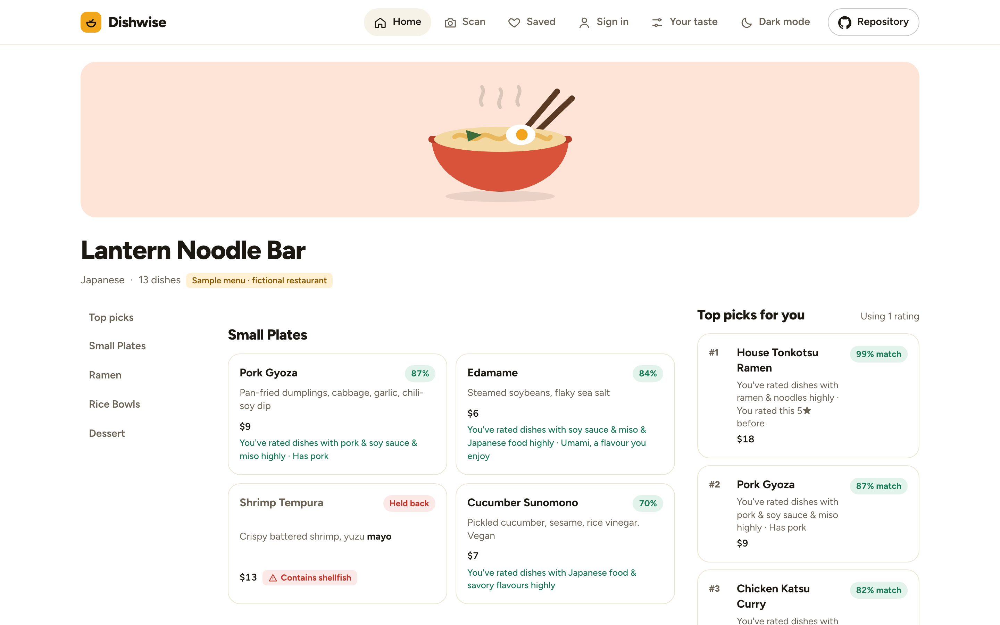

<p align="center"></p>

# Dishwise

**What should I order here?** Dishwise reads a restaurant menu from a photo or pasted text, ranks every dish against your taste, shows exactly why each dish scored what it did, and learns from what you rate.

**[Try it → dishwise.bhanusadhu.com](https://dishwise.bhanusadhu.com)** · free, no sign-up, and menu photos never leave your device.



<p align="center">
  
  &nbsp;
  
</p>

## The problem

Menus are long, vague and written for everyone. A diner with a strong taste, a diet or an allergy ends up guessing, asking staff, or ordering the same safe dish every time. Review apps rate restaurants, not dishes for *you*, and a general AI chat answers confidently without showing where the answer came from.

Goal: **a confident pick in under a minute, with reasons you can check.**

## How it works

1. **Taste profile.** Cuisines, favourite dishes, liked and avoided ingredients and flavours, heat tolerance, diet, allergies, budget. Every field is optional.
2. **Menu in.** Scan a photo (OCR runs in the browser), paste text from a restaurant site or delivery app, or open a fictional sample. A review step lets you fix anything the scanner misread.
3. **Enrichment.** Every dish attribute is tagged **stated** (the menu says so) or **inferred** (from a typical recipe). Anything else stays unknown and is never guessed.
4. **Ranking.** A deterministic scorer adds up evidence-backed points into a 0–100 match. Diet and allergy conflicts are held back, and the top picks are diversified so the short list isn't five ramens.
5. **Learning.** A 1–5★ rating updates feature weights, so similar dishes move on this menu and on every menu after it.


## Product decisions

| Decision | Trade-off |
| --- | --- |
| **An explainable additive scorer, not an ML model** | The reasons sum exactly to the score, it works on the first visit with zero data, and it's easy to test. It gives up whatever accuracy a model trained on real outcomes could reach, but no such data exists yet. |
| **"Stated" vs "inferred" on every attribute** | Menus are incomplete. Labelling a guess as "typical recipe" costs a little confidence in the UI but earns trust, which matters most for allergies. |
| **Never say "safe"** | A conflict is held back with "Contains / usually has X — confirm with staff". A test fails if any note says "safe", "allergen-free" or "guarantee". |
| **No collaborative filtering** | It needs many real users. Simulating them would fake the personalisation. |
| **OCR and ranking on the device** | $0 to run, photos stay private, results are instant. The cost is a ~9 MB first download (OCR models + ONNX Runtime), cached after that. |
| **No sign-up wall** | Everything works as a guest. An account only syncs taste and ratings across devices, and guest data merges in on first sign-in. |

More in [docs/DECISIONS.md](docs/DECISIONS.md) and [PRODUCT.md](PRODUCT.md).

## Architecture

```mermaid
flowchart LR
  photo["Menu photo, pasted text, or sample"] --> ocr["PaddleOCR (ONNX, WASM)<br/>in a Web Worker"]
  ocr --> parse["Parser<br/>prices, sections, columns"]
  parse --> review["Review step<br/>fix misreads"]
  review --> enrich["Enrichment<br/>stated or inferred"]
  enrich --> score["Additive scorer<br/>reasons sum to the score"]
  taste["Taste profile + learned weights"] --> score
  score --> rank["Ranking<br/>conflicts held back, MMR picks"]
  rank --> ratings["1–5★ ratings"]
  ratings -->|"update weights"| taste
  taste -.->|"synced when signed in"| neon[("Neon Postgres")]
```



Everything up to the ranking runs in the browser. The database stores only the taste profile and ratings of signed-in users. Scoring details are in [docs/ARCHITECTURE.md](docs/ARCHITECTURE.md).

## Hard problems

**Reading real menus, not clean ones.** The first OCR engine, Tesseract.js, read **0%** of prices on a blurred menu and on an angled, shadowed two-column phone photo (26.6% character error). Swapping in **PaddleOCR (PP-OCRv6 tiny)** in the browser and adding flat-field lighting correction took both to **100%** of dishes, prices and descriptions, across all nine test menus (worst character error 0.3%, one accent). Tesseract stays as a fallback. → [`src/lib/menu`](src/lib/menu), [docs/EVALUATION.md](docs/EVALUATION.md)

**A regression the real photos caught.** On five openly licensed real menu photos, PaddleOCR found far more (a far-away café board went from **1 → 49** rows) but fused dish names with their descriptions on a Thai set menu (**32 → 14** rows). A `splitFusedNameDescription` step, tested by replaying that photo's recorded boxes, brought it back to **31** rows with every name and description apart.

**Making the browser model fast enough.** PaddleOCR took up to **30.8 s** on a dense bistro menu because ONNX Runtime ran on one thread. Serving the site cross-origin isolated (COOP + COEP) lets it use up to 4 threads: **10.6 s**. A 1600 px detection cap was tried and dropped, since it saved ~0.3 s but lost dishes on two real menus.

**Scores you can audit.** A raw score is the exact sum of contributions, each with points, text, a source and an evidence reference, folded into 0–100 with a logistic curve. Learned weights use a shrunk average, `w = Σ c·x / (Σ x + 1.5)`, so one rating nudges and three consistent ratings move further. Top picks use Maximal Marginal Relevance. → [`src/lib/reco`](src/lib/reco)

## Results

- **130** unit and integration tests. They include a property check over **40** randomised profiles (every score is in 0–100 and equals the sum of its listed reasons), a test that no note ever says "safe", and Postgres integration tests (PGlite) running the shipped migrations.
- **132** Playwright E2E runs passing against production on desktop Chrome and a Pixel 7, including real in-browser OCR on an uploaded photo, the PaddleOCR → Tesseract fallback, guest-to-account merge and API authorization. 2 are skipped because they need a real test account; that path was verified by hand on production.
- **0** axe WCAG 2.1 A/AA violations on all 9 pages, the dish dialog and the scan review, plus 7 pages in dark mode. Keyboard use, 44 px touch targets and `prefers-reduced-motion` are supported.
- **Lighthouse (mobile):** Accessibility, Best Practices and SEO all **100**. LCP **643 ms**, CLS **0.00** on a throttled mobile trace. Both were measured before the redesign.

Not measured yet: Dishwise has no real-user data, so there are no satisfaction or real-world accuracy claims.

## How it was built

1. **Oct 29: engine first.** Recommendation engine, menu parser and evidence links, then Neon Postgres + Neon Auth, a Playwright suite and the first production deploy, all on day one.
2. **Oct 29: real-world hardening.** Real menu photos, menus pasted from delivery apps, account-flow coverage, and a by-hand real-account check confirmed in the live database. E2E found and fixed accessibility issues and a frozen form after a wrong password.
3. **Oct 29–30: from concept to consumer app.** The first "Marked-Up Menu" design was replaced by "Saffron", a consumer-app design for diners at the table and recruiters on laptops, plus dark mode and the bowl-and-tick mark.
4. **Nov 5: OCR engine swap.** PaddleOCR in the browser with Tesseract as fallback, judged on a rendered-menu evaluation.
5. **Nov 5: production loop.** One-click deploy, production E2E and real-photo checks as GitHub Actions. The real-photo run exposed the Thai-menu regression and the slow single thread, and both were fixed the same day.

## Tech stack

| Layer | Technology |
| --- | --- |
| Frontend | Next.js (App Router), React, TypeScript, Tailwind CSS |
| OCR | PaddleOCR PP-OCRv6 tiny on ONNX Runtime Web (WASM, Web Worker); Tesseract.js fallback |
| Data & auth | Neon Postgres, Drizzle ORM, Neon Auth; guest data in localStorage |
| Testing | Vitest, PGlite, Playwright, axe |
| Hosting | Vercel Hobby + Neon Free: **$0** to run ([COSTS.md](COSTS.md)) |

## Run it locally

```bash
npm install
npm run dev          # http://localhost:3000 (guest-only without env vars)
npm run check        # typecheck + lint + unit/integration tests
npm run test:e2e     # Playwright, desktop + mobile, against a production build
npm run eval:ocr     # OCR + parsing evaluation on rendered menus
npm run db:migrate   # apply Drizzle migrations to Neon (needs .env.local)
```

Accounts need the Neon variables in `.env.example`. Deploys are manual: `vercel deploy --prod`, or the "Deploy to production" GitHub Action.

## Project structure

```
src/
├── app/              # Pages (home, scan, menus, taste, notebook, account) and /api routes
├── components/       # App shell, dish dialog, taste editor, match badge
└── lib/
    ├── domain/       # Vocabulary, ingredient lexicon, zod schemas
    ├── menu/         # OCR worker, preprocessing, parser, enrichment, sample menus
    ├── reco/         # Scoring, learning from ratings, ranking
    └── db/           # Drizzle schema and user-scoped data access
tests/
├── e2e/              # Playwright: journeys, accounts, accessibility, security
└── ocr/              # Rendered-menu fixtures, OCR evaluation, real-photo runs
docs/                 # Architecture, decisions, design, evaluation
```

## What's next

Known limits:
- English menus only. Hand-written chalkboards and heavily angled photos still need a lot of correction in the review step.
- Scores are a compatibility index, not a calibrated probability that you'll enjoy a dish.
- PaddleOCR is 1.3–1.8× slower than Tesseract on real photos, and phones haven't been timed.

What to measure once real people use it, as privacy-friendly aggregate counts:
- time from landing to the first ranked menu (the "under a minute" goal);
- the share of scanned fields edited during review;
- the share of picks opened, saved or rated;
- the average rating of picks versus other dishes, the real test of the ranking.

[Architecture](docs/ARCHITECTURE.md) · [Decisions](docs/DECISIONS.md) · [Design](docs/DESIGN.md) · [Evaluation](docs/EVALUATION.md) · [Costs](COSTS.md) · [Third-party notices](THIRD_PARTY_NOTICES.md)

Sample restaurants are fictional. Cover illustrations were drawn for this project.
