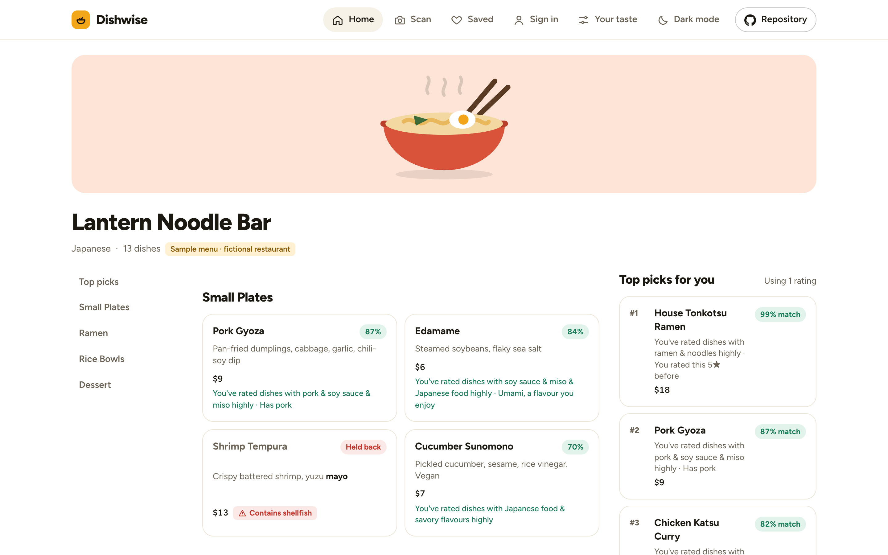
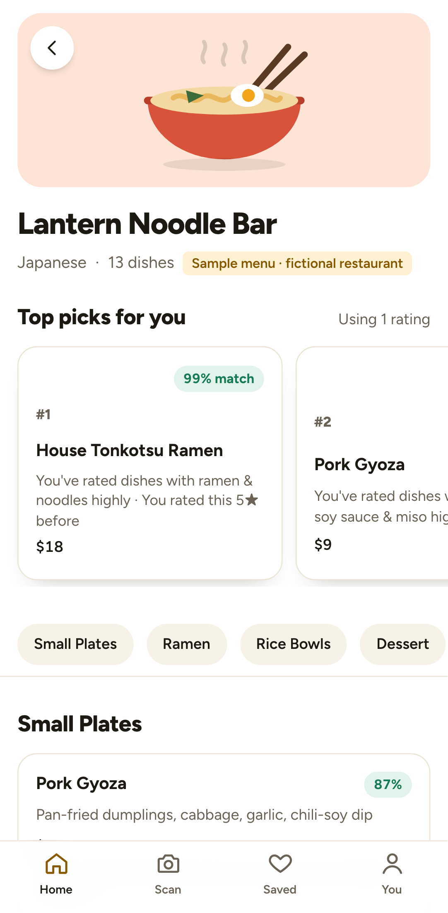
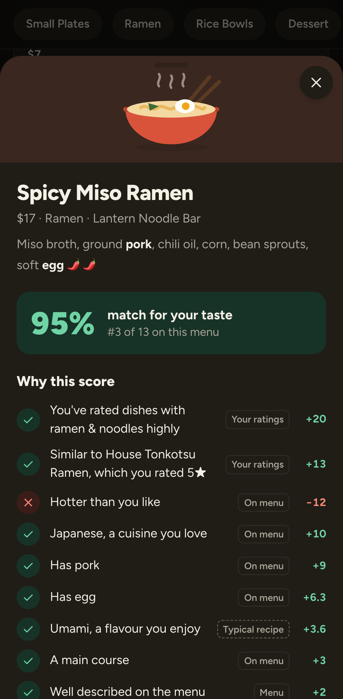
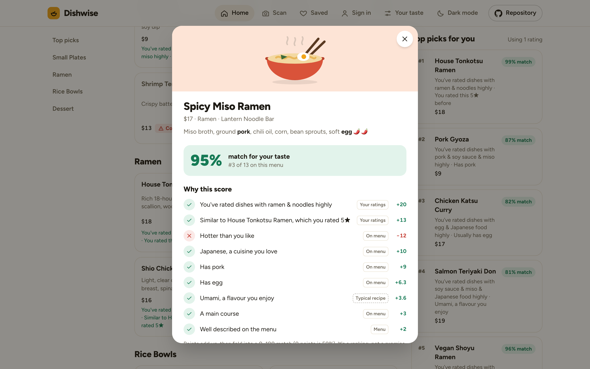

# Dishwise

**What should I order here?** Dishwise reads a restaurant menu (photo, pasted text, or a sample), ranks every dish against your taste, shows exactly why each dish scored what it did, and learns from what you rate.

**[Try it → dishwise.bhanusadhu.com](https://dishwise.bhanusadhu.com)** · no sign-up, free, and menu photos never leave your device.



<p align="center">
  
  &nbsp;
  
</p>

## The problem
Menus are long, vague and written for everyone. Diners with a strong taste, a diet or an allergy end up guessing, asking staff, or ordering the same safe dish every time. Review apps rate restaurants, not dishes for *you*. Generic AI chat answers sound confident but can't show where an answer came from.

Dishwise aims for **a confident pick in under a minute, with reasons you can check**.

## How it works
1. **Taste profile.** Cuisines, favourite dishes, liked or avoided ingredients and flavours, heat tolerance, diet, allergies and budget. Every field is optional.
2. **Menu in.** Scan a photo with Tesseract.js running in the browser, paste text (including from delivery apps), or try a fictional sample. A review step lets you fix anything the OCR misread.
3. **Enrichment.** Every attribute of a dish is tagged **stated** (the menu says so) or **inferred** (from a typical recipe). Anything else stays unknown and is never guessed.
4. **Ranking.** A deterministic scorer adds up evidence-backed points. Diet and allergy conflicts are held back, and picks are diversified so the short-list isn't five ramens.
5. **Learning.** Each 1–5★ rating updates feature weights, so similar dishes move on *this* menu and every other menu.



## Product decisions
| Decision | Trade-off |
| --- | --- |
| **An explainable additive scorer instead of an ML model** | Explanations are exact: the reasons sum to the score. It works from the first visit with zero data and is easy to test. It gives up any accuracy a model trained on real outcomes might reach, but no such data exists yet. |
| **"Stated" vs "inferred" on every attribute** | Menus are incomplete. Labelling guesses ("Typical recipe") costs some confidence in the UI but earns trust, which matters most for allergies. |
| **Never say "safe"** | Conflicts are held back with "Contains / Usually has X — confirm with staff". Tests fail if any note says "safe", "allergen-free" or "guarantee". |
| **No collaborative filtering** | It needs many real users. Faking them would fake the personalisation. |
| **OCR and ranking in the browser** | $0 to run, photos stay private, results are instant. The cost is weaker OCR than paid cloud APIs, so the review step is essential. |
| **No sign-up wall** | Everything works as a guest. An account only syncs taste and ratings across devices, and guest data merges in on first sign-in. |

More in [docs/DECISIONS.md](docs/DECISIONS.md) and [PRODUCT.md](PRODUCT.md).

## Engineering highlights
- **Scoring** ([`src/lib/reco`](src/lib/reco)): a raw score is the exact sum of contributions, each with points, text, a source and an evidence reference. It is folded into 0–100 with a logistic curve (raw 0 → 50). Learned weights use a shrunk average, `w = Σ c·x / (Σ x + 1.5)`, so one rating nudges and three consistent ratings move further. Top picks use Maximal Marginal Relevance. Details: [docs/ARCHITECTURE.md](docs/ARCHITECTURE.md).
- **Menu parsing** ([`src/lib/menu/parse.ts`](src/lib/menu/parse.ts)): price formats (`$12`, `€9,50`, `18 / 26`, `MP`, dot leaders), sections, two-column layouts found from an empty vertical gutter in a histogram of line positions, deskewing, re-attaching right-aligned prices, and restoring dropped decimals.
- **OCR evaluation** (`npm run eval:ocr`): seven rendered menus with exact ground truth, scoring the OCR error rate and parser precision/recall separately. Each fix in [docs/EVALUATION.md](docs/EVALUATION.md) was driven by inspecting raw Tesseract output.
- **Stack:** Next.js (App Router) · React · TypeScript · Tailwind CSS · Neon Postgres + Drizzle · Neon Auth · Tesseract.js · Vitest · Playwright. Hosted on Vercel Hobby and Neon Free for $0 ([COSTS.md](COSTS.md)).

## Quality
- **99** unit and integration tests, including property checks over 40 random profiles (every score is in 0–100 and equals its listed reasons) and Postgres integration tests (PGlite) running the shipped migrations.
- **128** Playwright E2E runs passing against production on desktop Chrome and a Pixel 7. They include real in-browser OCR on an uploaded photo, guest-to-account merge, and API authorization.
- **0** axe WCAG 2.1 A/AA violations on every page in light mode and on seven pages in dark mode. The app supports keyboard use, 44 px touch targets and `prefers-reduced-motion`.

Dishwise has no real-user data yet, so there are no satisfaction or accuracy claims. [docs/EVALUATION.md](docs/EVALUATION.md) lists what to measure once there is.

## Known limits
- English menus only. Chalkboards, handwriting and heavily angled photos still need a lot of correction in the review step.
- Scores are a compatibility index, not a calibrated probability that you'll enjoy a dish.

## Development
```bash
npm install
npm run dev          # http://localhost:3000 (guest-only without env)
npm run check        # typecheck + lint + unit/integration tests
npm run test:e2e     # Playwright, desktop + mobile, against a production build
npm run eval:ocr     # OCR + parsing evaluation on rendered menus
npm run db:migrate   # apply Drizzle migrations to Neon (needs .env.local)
```

Accounts need Neon env vars (see `.env.example`); `vercel env pull .env.local` fills them for the linked project. Deploys are manual: `vercel deploy --prod`.

## Docs
[Architecture & scoring](docs/ARCHITECTURE.md) · [Design](docs/DESIGN.md) · [Evaluation](docs/EVALUATION.md) · [Decisions](docs/DECISIONS.md) · [Progress](docs/PROGRESS.md) · [Costs](COSTS.md) · [Third-party notices](THIRD_PARTY_NOTICES.md)

Sample restaurants are fictional. Cover illustrations were drawn for this project.
