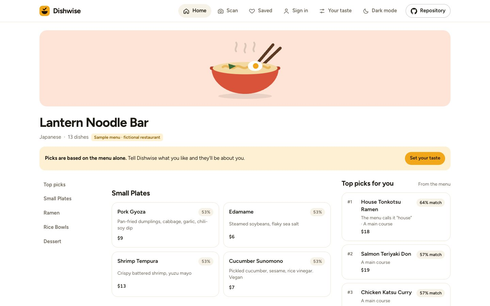
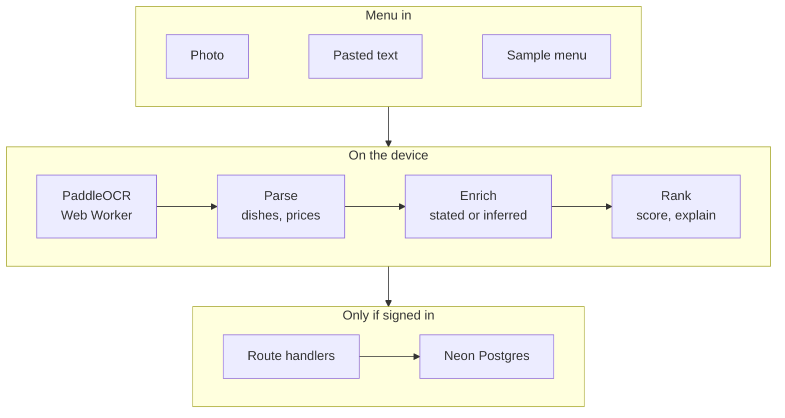
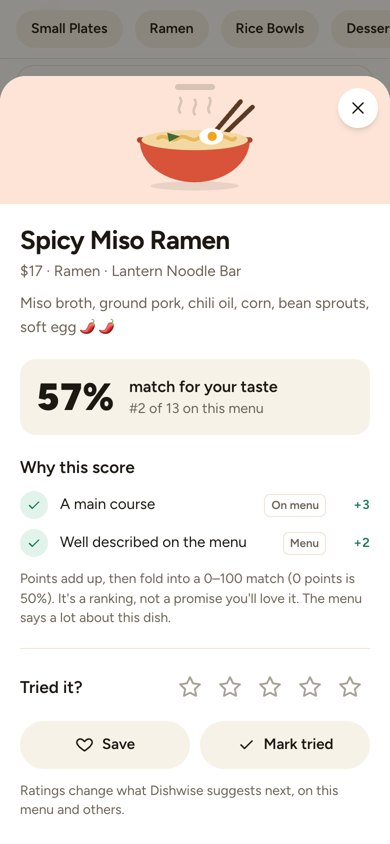

<p align="center"></p>

# Dishwise

**Photograph a menu and see every dish ranked against your taste, with the reason for each score.** Menu photos are read on your phone and never uploaded.

**[Try it → dishwise.bhanusadhu.com](https://dishwise.bhanusadhu.com)** · free, no sign-up


## The problem

You are at a table, phone in hand, with a menu you have never seen and a minute to decide. Reviews describe the restaurant, not the menu in front of you, and nothing knows that you hate cilantro, can handle heat or avoid shellfish. Delivery apps rank by popularity, so the answer is the same for everyone.

Dishwise aims for **a confident pick in under a minute, and trust in why.**

## How it works

1. **Bring a menu.** Scan a photo, paste text from a restaurant site or delivery app, type dishes, or open one of five fictional sample menus.
2. **Check what it read.** Every dish is listed for review, and uncertain reads are flagged so you can fix them before ranking.
3. **Say what you like.** Cuisines, favourite dishes, ingredients, flavours, heat, diet, things to avoid and budget. All optional.
4. **Read the ranking.** Each dish has a 0 to 100 match and a "why this score" list. Dishes that conflict with a diet or allergy are held back, never ranked.
5. **Rate it.** Stars and saves change what Dishwise suggests next, on this menu and others.



## Product decisions

| Decision | Trade-off |
| --- | --- |
| **Everything is read on the device** | Photos never leave the phone and the cost is $0. In return the first scan downloads about 9 MB of OCR model and runtime, and a dense menu can take around 10 seconds. |
| **A fixed, additive scoring formula, no ML model** | The score is exactly the sum of its shown reasons, so it can always be explained. It cannot discover taste patterns on its own. |
| **Every attribute is `stated` or `inferred`** | "Contains soy" can mean the menu says so or that Pad Thai usually has it. The label shows which, and a missing fact stays unknown, so some dishes look thinly explained. |
| **Never say "safe"** | A dish is a conflict, a likely conflict, labelled by the menu, or unverified with a "confirm with the restaurant" note. A user with an allergy still has to ask, and the product says so. |
| **No collaborative filtering** | A portfolio project has no multi-user data, and synthetic users would fake personalisation. Dishwise learns only from your own ratings. |
| **Guests first, accounts only to sync** | Taste and ratings live in `localStorage`. An account only syncs across devices, so clearing the browser loses a guest's data, in exchange for no sign-up wall. |

## Architecture



OCR, parsing, enrichment and ranking all run in the browser. The server only stores a signed-in user's profile, saved dishes and ratings. Details in [docs/ARCHITECTURE.md](docs/ARCHITECTURE.md).

## Hard problems

**Reading real menu photos in the browser.** Tesseract read clean renders perfectly and failed on a phone photo: **26.6% character error and no price read correctly** on a fixture with perspective, shadow, grain and JPEG loss. Switching to PaddleOCR's text detector (6.2 MB, ONNX Runtime Web in a Web Worker) already read the blurred prices, and dividing out the paper's uneven lighting took the same fixture to **0.3% error with every price correct**. The fix is engine-specific, because the same lighting correction made Tesseract worse. See [src/lib/menu](src/lib/menu).

**A regression the synthetic tests could not see.** On a real Thai set menu the new engine returned **14 rows against Tesseract's 32**, because it returns one box per line and a name and its smaller description arrived fused. A real-photo check on the live site caught it. A `splitFusedNameDescription` step, replayed against the recorded boxes in a test, brought it to **31 rows** with names and descriptions apart.

**Speed from a header change.** The dense bistro menu took **30.8 s** because ONNX Runtime ran on one thread. Serving the site cross-origin isolated (COOP and COEP headers) allowed four threads and cut it to **10.6 s**. Capping the detection size was tried and rejected, since every cap lost dishes on some photo.

**Explainable ranking.** A dish's raw score is the sum of contributions that each carry points, plain-language text, a basis (`stated`, `inferred`, `you` or `menu`) and a reference to the evidence, then `100 / (1 + e^(-raw/18))` squashes it to 0 to 100. It is a compatibility index, not a probability, and it has not been calibrated against real outcomes. See [src/lib/reco](src/lib/reco).



## Results

- **130 unit and integration tests in 9 files** (Vitest). They assert properties a recommender must have: different tastes give different top dishes, a 5 star rating lifts similar dishes on other menus, three consistent ratings move a learned weight more than one, saving counts less than a 5 star rating, and no output ever says a dish is "safe".
- **134 Playwright tests in 6 files** on desktop Chrome and a Pixel 7. The last run against production passed **132 and skipped 2**, which need a real Neon test account. That run included real in-browser OCR.
- **OCR evaluation:** nine rendered menus with exact ground truth. PaddleOCR matches or beats Tesseract on all nine, and the clear gains are on the degraded and phone-photo menus, where prices read correctly went from 0% to **100%**. Full table in [docs/EVALUATION.md](docs/EVALUATION.md).
- **Real photos:** five openly licensed menu photos, read on the live site by a GitHub Action. A far-away café board went from **1 row to 49**. There is no ground truth, so this is a reading, not a score.
- **Accessibility:** axe WCAG 2.1 A and AA reported **0 violations** on all 9 pages, the dish dialog and the scan review, plus 7 pages in dark mode.
- **Performance, before the redesign:** mobile LCP **643 ms** and CLS **0.00** on a throttled run, and Lighthouse 100 for accessibility, best practices and SEO. These were not re-run after the redesign.

**Not measured:** real users, whether picks match what people enjoy, handwriting and glare, non-English menus, and OCR timing on actual phones.

## How it was built

- **Engine first.** The scoring formula, the stated and inferred enrichment and the menu parser were written and tested before any interface.
- **Real data layer.** Neon Postgres and Neon Auth, with guest state merged into the account on first sign-in.
- **Two designs.** The first direction, a marked-up menu, was replaced soon after by a consumer-app design, because it read as a concept piece rather than something to use at a table.
- **Prove it on production.** End-to-end and accessibility suites run against the live site, and one-click GitHub Actions deploy, verify and read real photos.
- **Better OCR.** Tesseract was tuned until its limits showed, then PaddleOCR replaced it with Tesseract kept as the fallback.
- **The regression and the fix.** The real-photo run exposed the fused-line regression, and the fix plus cross-origin isolation followed.

## Tech stack

| Layer | Technology |
| --- | --- |
| Frontend | Next.js 16, React 19, TypeScript strict, Tailwind 4 |
| OCR | PaddleOCR PP-OCRv6 tiny on ONNX Runtime Web, Tesseract.js fallback, all in the browser |
| Backend and data | Next.js route handlers, Neon Postgres, Drizzle ORM, Neon Auth, zod |
| Testing | Vitest, Playwright, axe-core |
| Hosting | Vercel Hobby and Neon Free, $0 ([COSTS.md](COSTS.md)) |

## Run it locally

```bash
npm install
npm run dev            # http://localhost:3000, guests work without a database
npm run check          # typecheck, lint, unit tests
npm run test:e2e       # Playwright (set BASE_URL to test a deployed site)
npm run fixtures:ocr   # render the OCR test menus
npm run eval:ocr       # score the OCR engines on them
```

Environment variable names are in `.env.example`; accounts need a Neon database. Production deploys from the **Deploy to production** GitHub Action, and **Verify production** and **Real menu photos** check the live site.

## Project structure

```text
src/app/           pages: home, scan, menus, taste, notebook, account, how it works
src/components/    app shell, dish dialog, taste editor, scan review
src/lib/menu/      OCR, preprocessing, parser, enrichment, sample menus
src/lib/reco/      scoring, learning from ratings, ranking, evidence marks
src/lib/domain/    vocabulary, ingredient lexicon, dish archetypes, schemas
src/lib/db/        Drizzle schema and user-scoped data access
tests/             Playwright specs and the OCR evaluation
docs/              architecture, decisions, evaluation, design
```

## What's next

**Known limits**

- Fixtures are rendered, not photographed, so glare, curled paper, handwriting and occlusion are untested.
- The smallest PaddleOCR model is weaker on accented text and runs 1.3 to 1.8 times slower than Tesseract on the same photos.
- Only English menus have been tried, and the scoring weights are hand-set, not learned or calibrated.
- Browsers without cross-origin isolation run OCR on one thread.

**Next:** time OCR on real phones, test more menus from restaurants and delivery apps, and measure whether the explanations change what people order.

[Architecture](docs/ARCHITECTURE.md) · [Decisions](docs/DECISIONS.md) · [Evaluation](docs/EVALUATION.md) · [Design](docs/DESIGN.md) · [Costs](COSTS.md)
